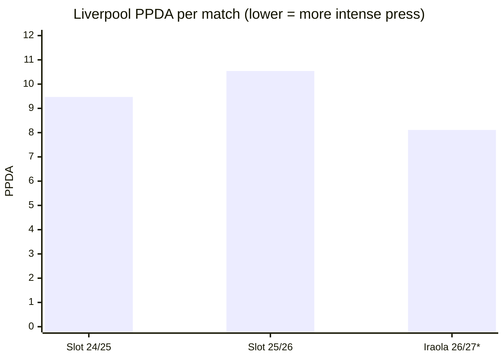

# Data visualisations

Data: Understat, `packages/etl/data/matches-*.json`, to 24 Oct 2026. Figures are per-match averages for Liverpool's Premier League matches.

Window: full seasons for Slot (2024/25, 2025/26 — 38 matches each). Iraola (2026/27) is 7 matches so far\*.

\* Small sample: 7 matches, one game moves the average a lot, and the opponents so far are not a full league's worth.

| Season | Manager | Matches | Record | Points per game |
|---|---|---|---|---|
| 2024/25 | Slot | 38 | 25W 9D 4L | 2.21 |
| 2025/26 | Slot | 38 | 17W 9D 12L | 1.58 |
| 2026/27 | Iraola\* | 7 | 3W 3D 1L | 1.71 |

## Liverpool's press: Slot vs Iraola

Question: does Liverpool press differently under Iraola than under Slot?

Metric: PPDA (passes allowed per defensive action) — opposition passes divided by Liverpool defensive actions. Lower = more intense press, not better.

| | Slot 2024/25 | Slot 2025/26 | Iraola 2026/27\* |
|---|---|---|---|
| PPDA | 9.47 | 10.54 | 8.11 |

Finding: Iraola's Liverpool is pressing harder than either Slot season. Slot's press dropped off in his second season.

## Does Iraola's Liverpool attack more than Slot's?

Claim: Iraola said in June 2026 Liverpool must be "intense, aggressive, vertical" and spend "as much time as we can in the opposition half, with the ball, without the ball" ([The Star](https://www.thestar.com.my/sport/football/2026/08/14/soccer-new-boss-iraola-aiming-to-re-ignite-liverpool-challenge-as-new-season-looms)).

| | Slot 2024/25 | Slot 2025/26 | Iraola 2026/27\* |
|---|---|---|---|
| xG | 2.45 | 1.77 | 1.51 |
| Goals | 2.26 | 1.66 | 1.29 |
| Deep completions | 11.6 | 9.8 | 6.3 |
| Shots | 17.1 | 15.4 | 15.7 |
| Shots on target | 6.1 | 4.6 | 5.0 |

Deep completions: completed passes, excluding crosses, into the area within about 20 metres of the opponent's goal ([Wyscout glossary](https://dataglossary.wyscout.com/deep_competion/); [StatsBomb](https://blogarchive.statsbomb.com/articles/soccer/learning-from-early-games/) says ~20 yards). Understat doesn't publish its own definition that I could find.

Finding: the "without the ball" half holds — the press is more intense. The "with the ball" half doesn't yet: shot volume matches Slot's second season, but xG, goals and deep completions are below both Slot seasons. Iraola said after the 0-0 with Fulham: "offensively we need to do much better" ([SoccerNews](https://www.soccernews.com/iraola-makes-no-excuses-for-lacklustre-liverpool-attack/404739/)).

## Defensively

Opponents' per-match averages against Liverpool:

| | Slot 2024/25 | Slot 2025/26 | Iraola 2026/27\* |
|---|---|---|---|
| Goals against | 1.08 | 1.39 | 1.14 |
| xG against | 1.11 | 1.42 | 1.34 |
| Shots against | 10.2 | 11.4 | 11.9 |
| Shots on target against | 3.7 | 4.0 | 3.4 |
| Deep completions against | 5.3 | 5.6 | 7.3 |
| Clean sheets | 14 (37%) | 10 (26%) | 3 (43%) |

Finding: Iraola's defence sits between Slot's two seasons on xG against, but is conceding fewer goals than its xG suggests, and opponents are getting the ball close to Liverpool's goal more often than under either Slot season (7.3 deep completions against). That fits a higher press being bypassed, but 7 matches is too few to say so.
